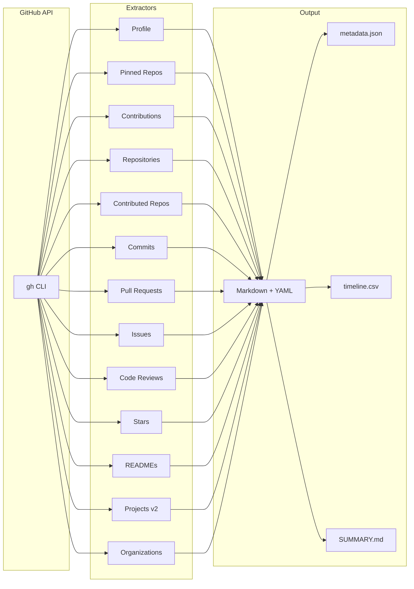
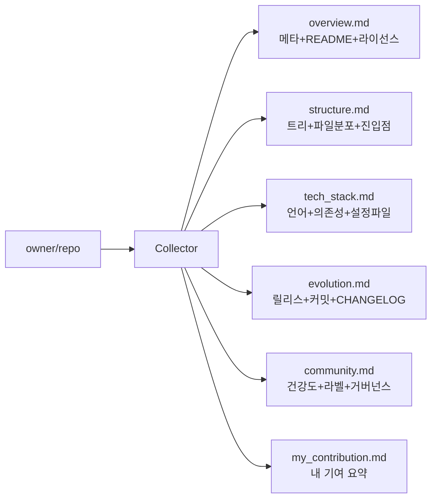
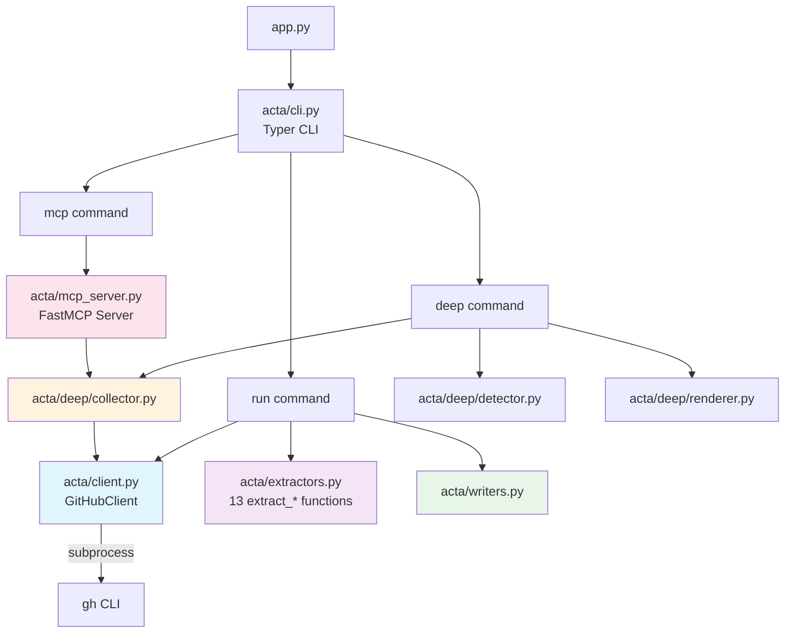

[](https://github.com/SukbeomH/HExoskeleton)

# Acta Ergo Sum

> *I act, therefore I am.*

GitHub 활동 데이터를 LLM 친화적 **Markdown 지식 베이스**로 수집하고,
특정 레포지토리를 딥 분석하여 프로젝트의 구조/기술 스택/설계 의도를 추출하는 CLI 도구.

**주요 명령:**
- `acta run` — 내 GitHub 활동 전체를 수집 (이력서/포트폴리오용)
- `acta deep` — 특정 레포를 분석하여 LLM이 프로젝트를 이해할 수 있는 컨텍스트 생성
- `acta mcp` — MCP 서버로 LLM 에이전트에게 도구를 직접 노출
- `acta analyze` — 수집한 자료와 기본·사용자 템플릿을 결합해 미검토 분석 프롬프트 생성
- `acta portfolio` — 프로젝트·본인 기여·근거를 확인하고 로컬 소개문을 보존·내보내기

---

## What It Collects

### `acta run` — 사용자 활동 수집



| Data Source | API | Output |
|---|---|---|
| User Profile | GraphQL | `profile.md` |
| Pinned Repos | GraphQL | `pinned.md` |
| Contribution Calendar | GraphQL | `contributions.md` |
| Owned Repositories | GraphQL | `repositories/*.md` |
| Contributed Repos | GraphQL | `repositories/*.md` |
| Commits | GraphQL | `commits/YYYY-MM.md` |
| Pull Requests | GraphQL | `pull_requests/*.md` |
| Issues | GraphQL | `issues/YYYY-MM.md` |
| Code Reviews | GraphQL | `reviews/YYYY-MM.md` |
| Stars | GraphQL | `stars/YYYY-MM.md` |
| READMEs | REST | `readmes/*_readme.md` |
| Projects (v2) | GraphQL | `projects/*.md` |
| Organizations | REST | `organizations/*.md` |

### `acta deep` — 레포지토리 딥 분석

특정 레포를 분석하여 LLM이 "이 프로젝트가 뭐고, 어떻게 설계됐고, 왜 만들었는지"를 이해할 수 있는 컨텍스트를 생성.



| Section | 데이터 소스 | 목적 |
|---|---|---|
| `overview.md` | GraphQL + README | 프로젝트 정체성 |
| `structure.md` | Git Tree + Languages API | 아키텍처 파악 |
| `tech_stack.md` | Dependency Graph + 핵심 파일 | 기술 스택 이해 |
| `evolution.md` | Releases + Commits + CHANGELOG | 진화 내러티브 |
| `community.md` | Community Profile + Labels | 운영/거버넌스 |
| `my_contribution.md` | Stats API | 개인 기여 정량화 |

---

## Prerequisites

| Requirement | Check | Notes |
|---|---|---|
| Python 3.12+ | `python3 --version` | |
| [uv](https://docs.astral.sh/uv/) | `uv --version` | Package manager |
| [GitHub CLI](https://cli.github.com/) | `gh auth status` | Must be authenticated |

## Installation

```bash
uv sync                    # 기본 의존성
uv sync --extra mcp        # MCP 서버 포함
```

## Usage

### 활동 수집 (`run`)

```bash
# 최근 365일 활동 수집 (기본)
uv run python app.py run

# 기간 / 출력 경로 지정
uv run python app.py run --days 90 --output ./my_data

# 빠른 실행 — 느린 단계 건너뛰기
uv run python app.py run --days 30 --skip-readmes --skip-stars

# 인증 확인
uv run python app.py whoami
```

수집한 커밋·PR·이슈·리뷰·스타는 `.records/`의 원본 기록을 고유키로 병합합니다.
반복 실행해도 이전 기록을 유지하며 `SUMMARY.md`, `timeline.csv`, 월별 파일은 누적 기록에서 생성합니다.
`--days` 등은 이번에 조회할 기간을 지정합니다. 별도의 기간별 자료가 필요하면 새 전용 `--output` 디렉터리를 사용하세요.
작업 디렉터리 자체나 상위 디렉터리는 출력 대상으로 사용할 수 없습니다.

```bash
# 성공한 단계별 기준 시각부터 증분 갱신
uv run python app.py run --since-last-run
```

기준 시각은 실행 시작 시점으로 기록합니다. 건너뛴 활동 단계는 기존 기록과 기준 시각을 유지합니다.
API 오류나 시간 초과가 발생하면 종료 코드 1을 반환하고 이전 출력과 기준 시각을 보존합니다.
기존 Markdown 출력에 원본 캐시가 없으면 원래 수집 기간을 한 번 다시 조회합니다.
이 이관이 필요한 활동 단계는 처음 한 번 `--skip-*` 없이 실행해야 합니다.
저장소와 README 파일명은 소유자를 포함한 `owner__repo.md`, `owner__repo_readme.md` 형식입니다.

### 근거 기반 포트폴리오 (`portfolio`)

첫 출시에서는 프로젝트 선택, 개인·팀 기여 확인, 소개문 내보내기와 재수집 후 검토를 제공합니다.
공고별 맞춤 생성과 외부 LLM 다듬기는 포함하지 않습니다. 추가 라이브러리 없이 Python 표준 SQLite를 사용합니다.

```bash
# 수집 결과와 분리된 작업 공간 생성
acta portfolio init --source ./acta_data --workspace ./portfolio
acta portfolio projects
acta portfolio select <project-id> --reason "플랫폼 직무와 관련" --disclosure public

# 선택한 프로젝트의 근거를 보고 발췌와 공개 판단을 편집
acta portfolio evidence list --project <project-id>
acta portfolio evidence edit <evidence-id>

# JSON 편집기로 본인 역할·행동·결과와 evidence_ids 작성
acta portfolio claim edit --project <project-id>
acta portfolio claim review <claim-id>
acta portfolio draft create --project <project-id>
acta portfolio draft edit <draft-id>
acta portfolio draft review <draft-id>
acta portfolio export <draft-id> --audience public --output ./portfolio_exports

# 기본 갱신은 로컬 파일만 읽음
acta run --since-last-run
acta portfolio refresh
acta portfolio review

# 연결한 원격 근거를 실제로 다시 조회할 때만 지정
acta portfolio refresh --probe-selected
```

`projects`는 수집 계정·시점·조회 범위와 후보를 함께 표시합니다. 프로젝트·주장·근거·초안 ID는 각 명령의 출력에 표시됩니다. 기본 작업 공간은 현재 디렉터리의 `./portfolio`입니다.
다른 경로는 `acta portfolio --workspace ./my_portfolio <command>`로 지정합니다.
GitHub 외 프로젝트는 `add-project --name "프로젝트명"`으로 추가합니다. 수집 없이 `portfolio init`으로 시작할 수도 있습니다.

편집기는 `scope`(`individual`, `team`, `unknown`), `role`, `problem`, `action`, `result`, `statement`,
`evidence_ids`, `result_kind`(`qualitative`, `measured`), `metrics`, `disclosure`를 보여줍니다.
수동 근거는 `manual_evidence`에 `excerpt`와 `disclosure`를 입력합니다. 자기 보고로 표시되며 독립적으로 검증된 사실을 의미하지 않습니다.
수치가 없어도 정성적 기여를 확인할 수 있습니다. 측정 결과에는 값·단위·기간·방법·연결 근거가 필요하고 비교에는 기준값과 조건도 필요합니다.
숫자 패턴은 검토 누락을 막는 보조 검사이며 사실의 진위를 자동 판정하지 않습니다.

`claim review`와 `draft review`는 정확한 본문과 근거를 보여준 뒤 사용자 확인을 받습니다.
`--show`는 확인 없이 조회합니다. 자동화에서는 이 출력의 `digest`와 `revision`을 `--approve <digest> --revision <revision>`으로 전달합니다.
편집 명령은 `--file <json>`과 `--revision <revision>`도 지원합니다. 편집 전의 revision을 전달하면 오래된 파일로 새 편집을 덮어쓰지 않습니다.
충돌하거나 잘못된 JSON을 저장하려 했을 때는 제안 내용을 작업 공간의 `edits/`에 보존합니다.

확인은 정확한 주장·문장·근거 버전에 연결됩니다. 내용을 수정하거나 연결 근거가 바뀌면 관련 확인이 무효가 됩니다.
재생성은 별도 초안을 만들고 이전 초안의 편집 이력은 유지합니다.
`draft list --project <project-id>`, `draft history <draft-id>`, `claim history <claim-id>`로 초안과 이전 버전·확인 이력을 다시 조회합니다. 새 관찰이 없는 캐시를 최신 확인이나 삭제로 해석하지 않습니다.
404는 삭제 확정이 아닌 접근 불가 또는 찾을 수 없음으로 기록하며, 요청 실패는 마지막 정상 내용을 유지합니다.

공개 내보내기는 프로젝트·블록·주장·발췌와 URL의 공개 여부를 함께 검사합니다.
기본값 `needs_review`나 비공개 자료가 있으면 중단하고 이유를 표시합니다. 명시적으로 제외할 문장은 `--exclude-block <block-id>`를 지정할 수 있습니다.
성공하면 유일한 디렉터리에 `document.md`와 공개 가능한 `evidence.json`을 함께 게시합니다. 원격 GitHub에는 쓰지 않습니다.

수집기의 `portfolio-source.json`은 버전·계정·범위·고정 식별자·실제 관찰을 담은 단일 입력입니다.
이 파일이 없는 이전 출력은 `portfolio init --source ./acta_data --legacy`로 명시적으로 이관할 수 있습니다.
고정 ID·공개 상태·관찰 시점이 없으면 미확인으로 남습니다. 재수집이나 선택 근거 조회로 보완하거나 수동 기록을 작성하세요.

작업 공간의 정본은 `portfolio/workspace.sqlite3`입니다. 수집 결과와 경로를 겹치게 지정할 수 없습니다.
일관된 DB 백업은 `acta portfolio backup --output ./portfolio-backup.sqlite3`로 생성합니다.
기존 `analyze` 출력은 미검토 초안이며 포트폴리오 확인 상태를 자동으로 얻지 않습니다.

### 레포 딥 분석 (`deep`)

```bash
# 특정 레포 분석 → deep_analysis/{repo}/ 에 파일 생성
uv run python app.py deep owner/repo

# stdout 모드 — LLM 에이전트에 파이프
uv run python app.py deep owner/repo --stdout

# 내 기여 분석 포함
uv run python app.py deep owner/repo --include-me
```

### MCP 서버 (`mcp`)

```bash
# MCP 서버 시작 — Claude Code, Cursor 등에서 tool로 연결
uv run python app.py mcp
```

MCP 추가 의존성은 SDK 1.x(`>=1.30,<2`)를 사용합니다. stdio 연결에서 진행 로그는 stderr로 출력합니다.

MCP로 노출되는 도구:

| Tool | 용도 |
|---|---|
| `deep_analyze_repo` | 전체 딥 분석 (섹션 선택 가능) |
| `get_repo_structure` | 디렉토리 트리 + 파일 분포 |
| `get_repo_key_files` | 핵심 설정 파일 내용 (manifest, CI, docs 등) |
| `get_repo_evolution` | 릴리스 + 커밋 + CHANGELOG |

### 활동 수집 옵션

| Flag | Default | Description |
|---|---|---|
| `--days`, `-d` | `365` | 수집 기간 (일) |
| `--months`, `-m` | `0` | 수집 기간 (월, --days보다 우선) |
| `--years`, `-y` | `0` | 수집 기간 (년) |
| `--output`, `-o` | `./acta_data` | 출력 디렉토리 |
| `--skip-readmes` | `false` | README 수집 건너뛰기 |
| `--skip-commits` | `false` | 커밋 수집 건너뛰기 |
| `--skip-prs` | `false` | PR 수집 건너뛰기 |
| `--skip-issues` | `false` | 이슈 수집 건너뛰기 |
| `--skip-reviews` | `false` | 리뷰 수집 건너뛰기 |
| `--skip-stars` | `false` | 스타 수집 건너뛰기 |
| `--skip-contributed` | `false` | 기여 레포 수집 건너뛰기 |
| `--since-last-run` | `false` | 단계별 마지막 성공 시점부터 갱신하고 기존 기록과 병합 |

---

### 분석 프롬프트 생성 (`analyze`)

```bash
# 설치된 기본 템플릿 사용 — 현재 디렉터리와 무관
uv run python app.py analyze -t profile -i ./acta_data

# 사용자 템플릿 디렉터리 지정
uv run python app.py analyze -t profile -i ./acta_data --template-dir ./my_templates
```

기본 템플릿 `profile`, `resume`, `weekly`, `project-summary`는 `acta/templates/`에 포함되며 wheel에도 함께 설치됩니다.
생성된 프롬프트는 입력 디렉터리의 `analysis/`에 저장합니다.

## Output Structure

### `acta run` 출력

```text
acta_data/
├── portfolio-source.json  # 버전 있는 포트폴리오 입력과 실제 관찰
├── .records/              # 누적 활동 원본 JSON — 증분 실행 시 유지
├── profile.md             # 사용자 프로필 (bio, location, social)
├── pinned.md              # 핀된 레포 (포트폴리오 하이라이트)
├── contributions.md       # 잔디 데이터 (streak, 월별/요일별 집계)
├── repositories/          # owner__repo.md (owned + contributed)
├── commits/               # YYYY-MM.md — 월별 커밋
├── pull_requests/         # PR별 .md (리뷰, 상태, 설명)
├── issues/                # YYYY-MM.md — 월별 이슈
├── reviews/               # YYYY-MM.md — 코드 리뷰
├── readmes/               # README 아카이브
├── stars/                 # YYYY-MM.md — 스타 레포
├── projects/              # GitHub Projects v2
├── organizations/         # 소속 조직
├── metadata.json          # LLM용 인덱스
├── timeline.csv           # 시계열 로그
└── SUMMARY.md             # 활동 리포트
```

### `acta deep` 출력

```text
deep_analysis/{repo}/
├── overview.md            # 메타 + README + 라이선스
├── structure.md           # 트리 + 파일 분포 + 진입점
├── tech_stack.md          # 언어 + 의존성 + 설정 파일 내용
├── evolution.md           # 릴리스 노트 + CHANGELOG + 커밋 요약
├── community.md           # 건강도 + 라벨 분포 + 거버넌스
├── my_contribution.md     # (--include-me) 내 기여 통계
└── metadata.json          # 분석 메타데이터
```

---

## Architecture



### Module Breakdown

| Module | Responsibility |
|---|---|
| `acta/client.py` | `GitHubClient` — REST/GraphQL via `gh` CLI |
| `acta/extractors.py` | 13 `extract_*` functions (profile, pinned, calendar, repos, commits, PRs, issues, reviews, stars, readmes, projects, orgs, contributed) |
| `acta/writers.py` | MD/JSON/CSV/Summary 출력 |
| `acta/cli.py` | Typer CLI (`run`, `deep`, `mcp`, `analyze`, `whoami`) |
| `acta/deep/collector.py` | 레포 딥 분석 데이터 수집 |
| `acta/deep/detector.py` | 핵심 파일/진입점 자동 감지 |
| `acta/deep/renderer.py` | 딥 분석 마크다운 렌더링 |
| `acta/mcp_server.py` | FastMCP 서버 (4 tools) |

### Design Decisions

| Decision | Rationale |
|---|---|
| `gh` CLI 래핑 | 인증/토큰 관리를 `gh`에 위임 |
| Dependency Injection | `GitHubClient` 주입으로 테스트 격리 |
| `FakeGitHubClient` | subprocess 없는 빠른 테스트 |
| YAML Frontmatter | LLM 파싱 가능한 구조화 메타데이터 |
| `--stdout` 모드 | LLM 에이전트에 직접 파이프 가능 |
| MCP 서버 | Claude Code/Cursor 등에서 tool로 직접 호출 |
| 핵심 파일 자동 감지 | 매니페스트/CI/Dockerfile 등 패턴 매칭 |

---

## Testing

```bash
uv sync --dev --extra mcp
uv run pytest tests/ -v
uv build
uv run python scripts/check_wheel.py dist/*.whl
```

CI는 Python 3.12와 3.13에서 수집 회귀 테스트와 전체 테스트를 실행합니다.
wheel 검증은 소스 디렉터리 밖의 격리된 환경에서 기본·사용자 템플릿, 설치된 CLI의 포트폴리오 완주, 실제 MCP stdio 초기화·도구 조회·호출을 확인합니다.
MCP 테스트의 GitHub 응답은 가짜 `gh` 실행 파일로 제공하므로 인증이나 네트워크가 필요하지 않습니다.

---

## License

MIT
